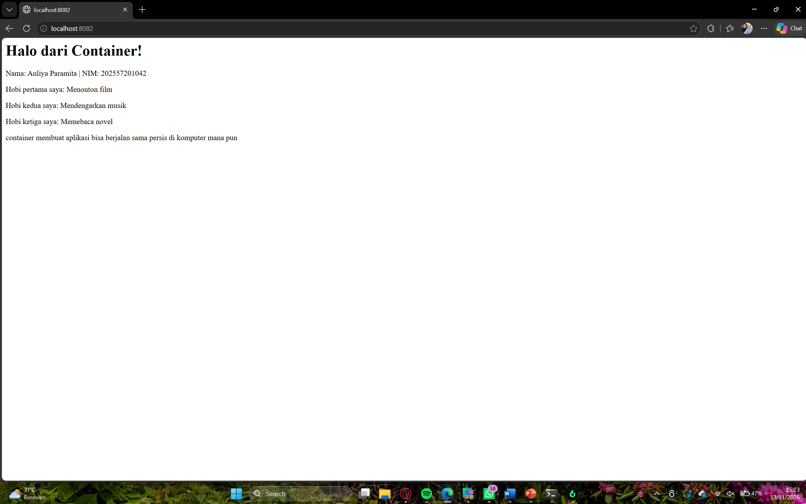
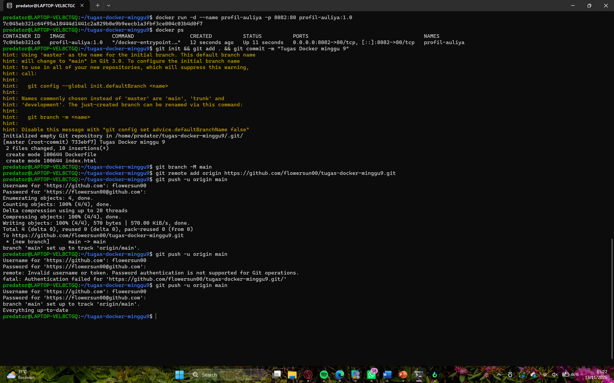
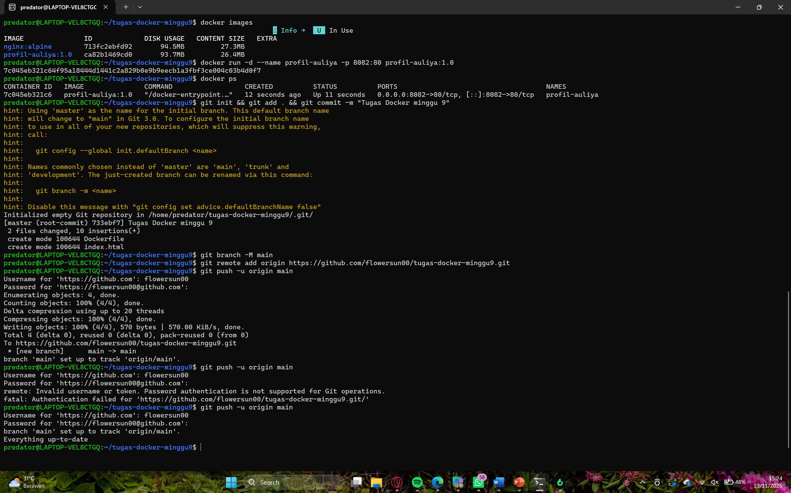

# Tugas Docker Minggu 9: Kontainerisasi Halaman Profil

Proyek ini mengemas halaman profil pribadi ke dalam image Docker berbasis Nginx, lalu menjalankannya sebagai container.

Nama: Auliya Paramita
NIM: 202557201042
Kelas: A

## Struktur File

- `index.html` : halaman profil
- `Dockerfile` : resep pembuatan image
- `README.md` : dokumentasi proyek
- `screenshots/` : bukti hasil praktik

## Teknologi

- Docker
- Nginx (image dasar `nginx:alpine`)
- HTML

## Cara Build Image

```bash
docker build -t profil-auliya:1.0 .
```

## Cara Menjalankan Container

```bash
docker run -d --name profil-auliya -p 8082:80 profil-auliya:1.0
```

## Cara Mengakses

Buka browser, lalu kunjungi `http://localhost:8082`.

## Screenshot

 


